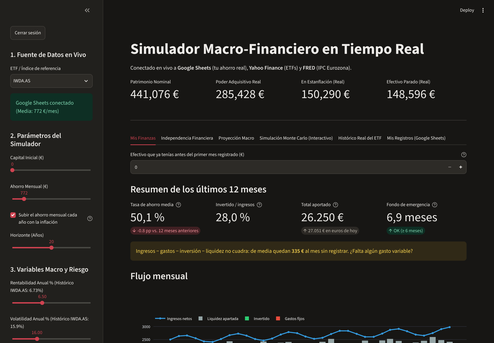
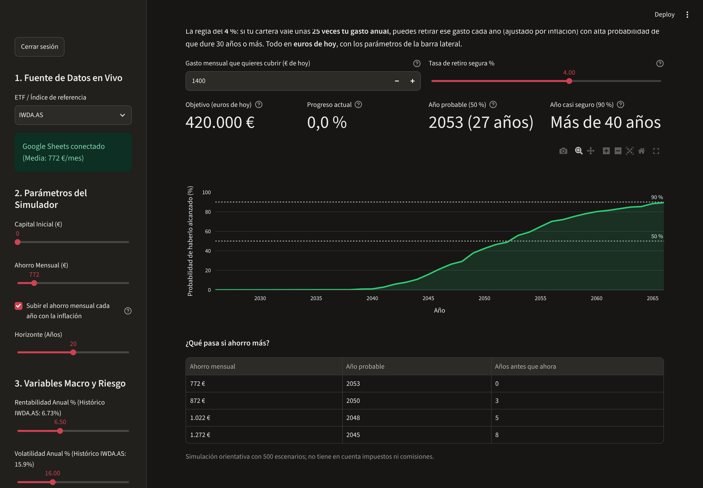
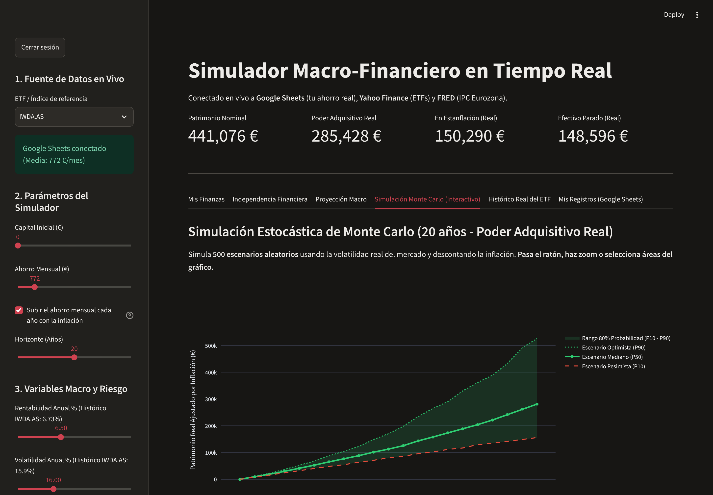

# Simulador Macro-Financiero en Tiempo Real

Aplicación web en **Python + Streamlit** que conecta mis finanzas personales (registradas en **Google Sheets**) con datos de mercado (**Yahoo Finance**) y de inflación de la Eurozona (**FRED**). Responde a una pregunta concreta:

> **¿Cuánto poder adquisitivo real tendré en el futuro, y cuándo podría vivir de mis inversiones?**

🔗 **App en vivo:** [proyecto-ahorro-macro.streamlit.app](https://proyecto-ahorro-macro-hd6ww2gwmwlbkd6r3ufd8d.streamlit.app/) (acceso protegido con contraseña porque muestra datos personales)



> Las capturas de este README usan **datos de ejemplo**, no datos reales.

---

## El problema

La mayoría de simuladores de ahorro muestran cifras **nominales**: "tendrás 400.000 € en 20 años". Pero con un 2-3 % de inflación anual, esos euros valdrán bastante menos. Además, suelen partir de supuestos inventados, no de lo que la persona ahorra de verdad.

Esta app:
1. Parte de **mis datos reales** de ingresos, gastos e inversión, que actualizo cada mes en Google Sheets.
2. Usa la **rentabilidad y volatilidad históricas reales** del ETF en el que invierto.
3. Descuenta la **inflación oficial de la Eurozona** para expresar todo en **euros de hoy**.
4. Simula **500 escenarios de mercado** para dar rangos de probabilidad en lugar de una única cifra.

---

## Qué hace

| Pestaña | Qué muestra |
|---|---|
| **Mis Finanzas** | Tasa de ahorro, % de ingresos invertido, capital aportado en nominal y ajustado por IPC, meses de fondo de emergencia, flujo mensual, **inflación personal** (cuánto suben mis gastos frente al IPC) y reparto por activo. |
| **Independencia Financiera** | Objetivo según la **regla del 4 %**, **probabilidad de alcanzarlo cada año** y cuántos años antes llegaría ahorrando 100, 250 o 500 € más al mes. |
| **Proyección Macro** | Proyección determinista: patrimonio nominal, poder adquisitivo real, escenario de **estanflación** y comparación con dejar el dinero sin invertir. |
| **Simulación Monte Carlo** | 500 trayectorias aleatorias con la volatilidad real del ETF, con bandas de percentiles P10 / P50 / P90 en euros de hoy. |
| **Histórico del ETF** | Cotización de hasta 10 años del ETF elegido (IWDA, VWCE, SPY, QQQ), con su CAGR y volatilidad. |
| **Mis Registros** | La tabla de Google Sheets tal y como se lee en vivo. |

Todos los parámetros (capital inicial, ahorro mensual, horizonte, rentabilidad, volatilidad, inflación y escenario de estrés) se ajustan desde la barra lateral. Los valores por defecto salen de los datos reales.

<table>
<tr>
<td></td>
<td></td>
</tr>
</table>

---

## Fuentes de datos

| Fuente | Datos | Cómo se obtiene |
|---|---|---|
| **Google Sheets** | `Fecha`, `Ingresos_Netos`, `Gastos_Fijos`, `Ahorro_Invertido`, `Activo_Principal`, `Liquidez_Efectivo` (un registro por mes) | API de Google con una **cuenta de servicio** (`gspread`) |
| **Yahoo Finance** | Precios de cierre diarios del ETF (hasta 10 años) | `yfinance` |
| **FRED** (Reserva Federal de St. Louis) | IPC armonizado de la Eurozona, serie `CP0000EZ19M086NEST` | CSV público de FRED, leído con `pandas` |

Los datos se guardan en caché (`st.cache_data`): Google Sheets durante 5 minutos y los datos de mercado durante 1 hora. Así la app es rápida sin saturar las fuentes.

---

## Cómo funciona por dentro

### Métricas de mercado
- **CAGR** (crecimiento anual compuesto), calculado con los **años reales** de histórico. Así no se infravaloran ETFs más jóvenes, como VWCE, que cotiza desde 2019.
- **Volatilidad anualizada**: desviación típica de los rendimientos diarios × √252.
- **Inflación interanual**: IPC del último mes frente al mismo mes del año anterior.

### Motor de proyección (mensual)
Las dos simulaciones, determinista y Monte Carlo, siguen las **mismas reglas**, para que sus resultados sean comparables:
- La cartera rinde en términos **nominales** y se aporta al inicio de cada mes.
- Opcionalmente, la aportación mensual **sube cada año con la inflación**, para mantener su poder adquisitivo.
- El resultado se **deflacta** con la inflación acumulada para expresarlo en euros de hoy.

### Monte Carlo
- **Rendimientos mensuales log-normales**: la mediana de las trayectorias crece a la rentabilidad elegida, y la volatilidad genera la dispersión.
- 500 escenarios vectorizados con **NumPy**, con semilla fija para que los resultados sean reproducibles.
- Horizonte mínimo de 40 años, compartido con la pestaña de independencia financiera y guardado en caché.

### Independencia financiera
- Objetivo = gasto anual / tasa de retiro (4 % por defecto, es decir, 25 veces el gasto anual).
- Para cada año se calcula el **% de escenarios** que ya han superado el objetivo, y se muestran los años en que esa probabilidad llega al 50 % y al 90 %.

### Calidad de los datos
Los datos introducidos a mano en una hoja de cálculo suelen tener inconsistencias, así que el módulo `finanzas.py`:
- Entiende números en formato español e inglés (`1.234,56 €`, `1234.5`).
- Entiende fechas `dd/mm/aaaa`, `aaaa-mm-dd` y `mm/aaaa`.
- Avisa de **meses que faltan**, **meses repetidos**, **registros desactualizados** e importes que no cuadran (ingresos ≠ gastos + inversión + liquidez).
- Si falla alguna fuente externa, la app **sigue funcionando** con valores por defecto y lo **indica claramente**, en lugar de mostrar cifras inventadas sin avisar.

---

## Stack tecnológico

| Capa | Tecnología |
|---|---|
| Lenguaje | Python 3.11 |
| Interfaz web | Streamlit |
| Datos y cálculo | pandas, NumPy |
| Gráficos interactivos | Plotly |
| Integraciones | gspread (Google Sheets API), yfinance, FRED |
| Despliegue | Streamlit Community Cloud (despliegue automático desde `main`) |
| Entorno de desarrollo | Dev Container (GitHub Codespaces / VS Code) |
| Pruebas | `streamlit.testing.AppTest` con fuentes externas simuladas (mocks) |

---

## Seguridad

- **Credenciales fuera del código**: la cuenta de servicio de Google y la contraseña viven en *Secrets* de Streamlit, y `.streamlit/secrets.toml` está en `.gitignore`.
- **Acceso con contraseña**: la comparación se hace en tiempo constante (`hmac.compare_digest`) y la sesión se puede cerrar desde la app. Si la contraseña no está configurada, la app avisa de que es pública.
- **Permisos mínimos**: la cuenta de servicio solo tiene acceso a la hoja compartida con ella.

---

## Estructura del proyecto

```
├── app.py               # App Streamlit: datos de mercado, simulaciones y pestañas
├── finanzas.py          # Limpieza y análisis de la hoja de Google Sheets
├── requirements.txt     # Dependencias
├── .devcontainer/       # Entorno de desarrollo reproducible
└── docs/img/            # Capturas para este README
```

---

## Ejecutarla en local

```bash
git clone https://github.com/blanca-111/Proyecto-ahorro-macro.git
```

```bash
cd Proyecto-ahorro-macro
```

```bash
pip install -r requirements.txt
```

Crea `.streamlit/secrets.toml`:

```toml
app_password = "elige-una-contraseña"

[gcp_service_account]
type = "service_account"
project_id = "..."
private_key = "..."
client_email = "...@....iam.gserviceaccount.com"
# ... resto del JSON de la cuenta de servicio
```

Comparte una hoja llamada `Mi_Ahorro_Mensual` con el `client_email` de la cuenta de servicio y ejecuta:

```bash
streamlit run app.py
```

Sin credenciales de Google, la app también arranca: muestra un aviso y usa valores por defecto.

---

## Próximos pasos

- [ ] Leer el valor real de la cartera para calcular la rentabilidad obtenida (TWR / XIRR).
- [ ] Guardar la proyección en una pestaña de Google Sheets y compararla con la evolución real (plan frente a realidad).
- [ ] Separar gastos fijos y variables para afinar el objetivo de independencia financiera.
- [ ] Resumen mensual automático generado con IA.

---

## Aviso

Herramienta personal con fines educativos. Las simulaciones no tienen en cuenta impuestos ni comisiones y **no constituyen asesoramiento financiero**.
